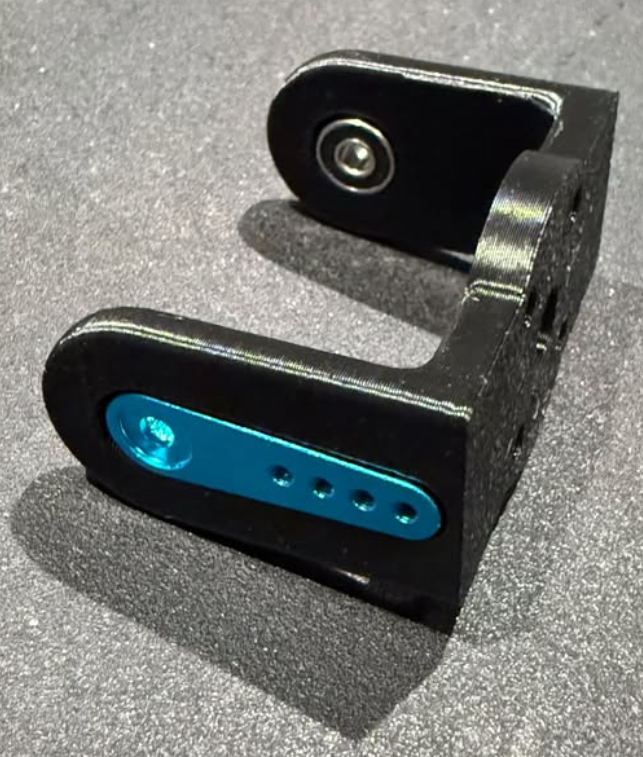
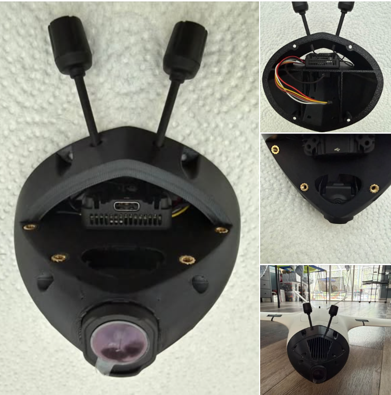
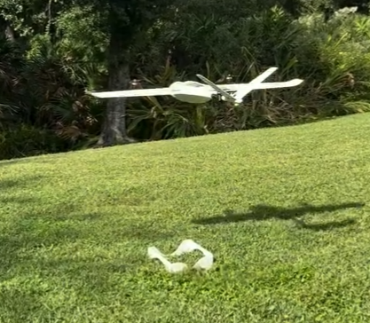
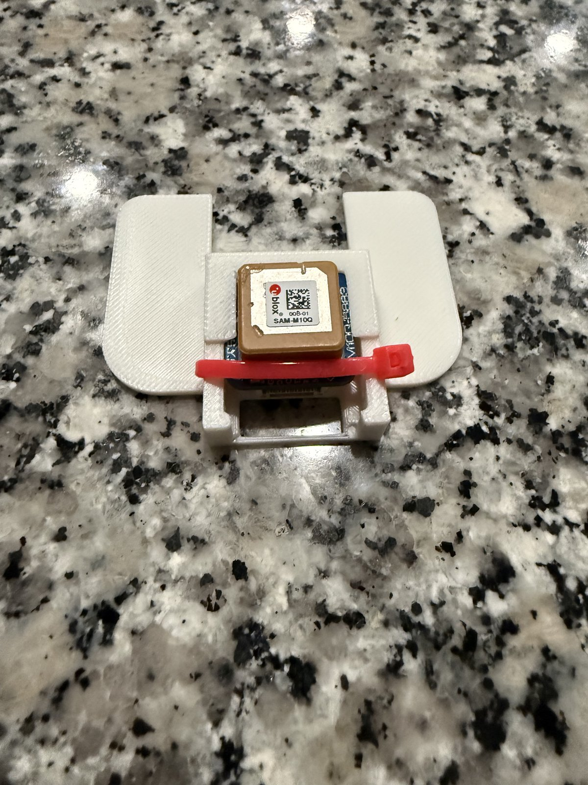
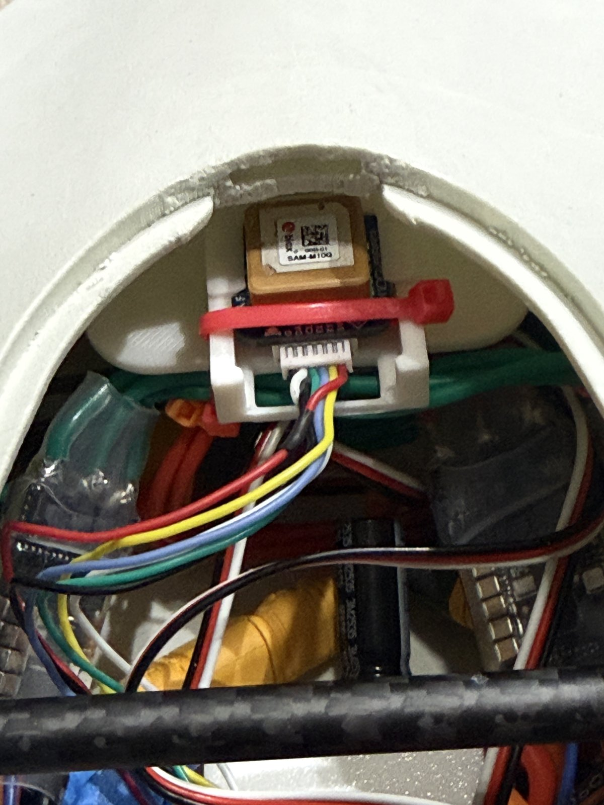
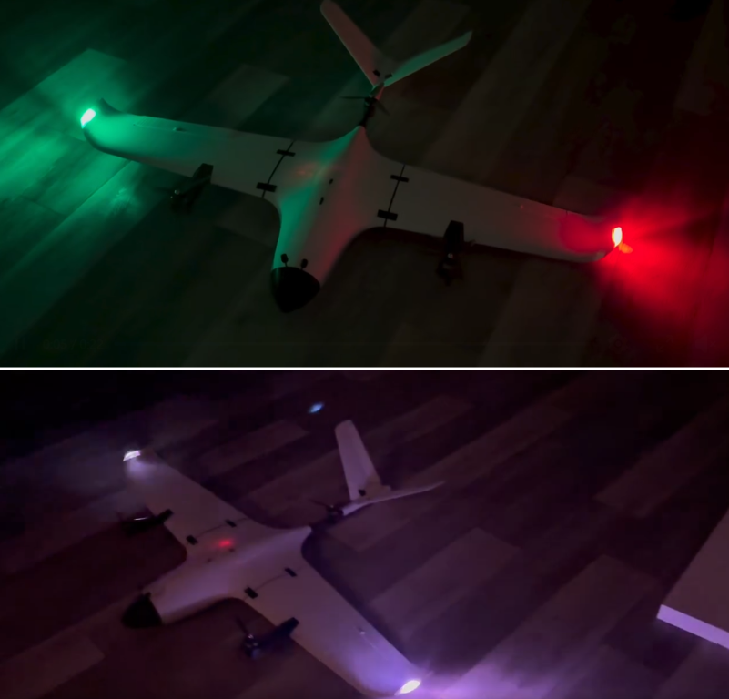

# FlightoryGenCodeMods — Stallion VTOL

Motor-mount modification and wingtip LED scripts for the Flightory Stallion VTOL. All files are in the repository root.

## Motor Mount

Modified front motor mount for the SPARKHOBBY / KINGMAX KM1203MD mini digital
servo. The mount accommodates the larger metal servo horn/arm, with changes
specifically supporting the Kingmax 1203MD metal-arm option linked from the
product site.

| File | Contents |
| --- | --- |
| `MOTOR MOUNT FRONT-LARGER-HORN-METAL.f3d` | Editable Fusion 360 design |
| `MOTOR MOUNT FRONT-LARGER-HORN-METAL.stl` | Printable mesh |

## O4 Air Pro Nose Cone Mods

I modified the O4 Air Pro nose cone and its matching cover.

Related files:

| File | Contents |
| --- | --- |
| `NOSE-O4-AIR-PRO.stl` | Modified nose cone for the O4 Air Pro |
| `NOSE-O4-AIR-PRO-COVER.stl` | Modified cover for the O4 Air Pro nose cone |

## Stallion Cradle

The Stallion cradle was designed by Robert Triggs; full credit for the original
design goes to Robert. I split it into two parts so it can be printed without
supports. It is useful as a work stand, takeoff pad, and aid for calibrating
the accelerometer.

Related files:

| File | Contents |
| --- | --- |
| `Stallion cradle 1-2.stl` | First half of the split Stallion cradle |
| `Stallion cradle 2-2.stl` | Second half of the split Stallion cradle |

## Stallion GPS Holder

GPS holder for the Matek Systems M10Q-5883 GPS & Compass Module.

  
  

Related files:

| File | Contents |
| --- | --- |
| `StallionGPS.stl` | Printable GPS holder |

## Wingtip LED Scripts

Two SpeedyBee WS2812 boards, four LEDs per wing, controlled by a TBS Lucid H7 Wing running ArduPilot Lua through S13. No separate LED controller is used.

### stallion_led_nav.lua

- Left wing red; right wing green. All four LEDs on each wing show their
  navigation colour between flashes.
- Rear two LEDs per wing double-flash white; front two remain red/green.
- Full-brightness navigation colours and white strobes.
- Normal navigation lights and white double strobe show only when READY TO ARM
  or ARMED. While disarmed and not ready to arm, navigation lights are off and
  all eight pixels show the pre-arm status:
  - No GPS 3D fix and EKF not ready: red for 1 s, amber for 1 s, alternating.
  - No GPS 3D fix only: red 1 s on, 1 s off.
  - EKF not ready only: amber 1 s on, 1 s off.
  - GPS and EKF OK, but another pre-arm check failing (for example, no radio):
    fast amber blink, 250 ms on/off. See `PreArm:` in the GCS Messages.
- Strobe timing: 60 ms flash, 80 ms gap, 60 ms flash, 900 ms pause.

#### How Status Is Decided

- GPS OK means the primary GPS has a 3D fix or better.
- EKF OK means `ahrs:healthy()`.
- Ready means `arming:pre_arm_checks()` passes.
- While disarmed, GPS/EKF/pre-arm are checked every 1 s; armed is checked
  every loop.

#### User Settings

| Setting | Value | Purpose |
| --- | --- | --- |
| `RED` | `{255,0,0}` | GPS status |
| `AMBER` | `{255,100,0}` | EKF and other pre-arm status |
| `OFF` | `{0,0,0}` | Status blink off phase |
| `STATUS_HALF_MS` | `1000` | Status blink, 1 s on/off |
| `OTHER_HALF_MS` | `250` | Fast blink for other pre-arm failures |
| `STATUS_CHECK_MS` | `1000` | Status re-check interval while disarmed |

#### GCS Messages

- Startup: `STALLION LED: status lights v2 started`
- On each state change, `STALLION LED: ` followed by one of:
  - `no GPS fix + EKF not ready (red/amber)`
  - `no GPS fix (red blink)`
  - `EKF not ready (amber blink)`
  - `other pre-arm check failing (fast amber)`
  - `ready to arm (nav lights)`
  - `armed (nav lights)`

#### Compatibility

Flown on ArduPlane 4.6.3 (TBS Lucid H7 Wing). Every Lua function used exists
in ArduPlane 4.7.2 (checked against the 4.7.2 scripting docs). Not yet flown
on 4.7.

#### Changelog

- v2: Added the GPS/EKF/pre-arm status light patterns while disarmed; nav
  lights now show only when ready to arm or armed.

### stallion_led_demo.lua

Four patterns run for five seconds each, then repeat:

1. **UFO orbit:** purple comet with a fading trail through all eight LEDs in data-chain order.
2. **Police pursuit:** alternating red/blue double flashes between wings.
3. **Rainbow chase:** moving rainbow colours across all eight LEDs.
4. **Reactor pulse:** cyan pulse with a white flash at the peak.

Brightness is controlled by `BRIGHTNESS` (0–255). The demo setting used for this build is `180`.

## LED Wiring

| Source | Destination |
| --- | --- |
| FC S13 | Left-wing DIN |
| Left-wing DOUT | Right-wing DIN, routed through the fuselage |
| Right-wing DOUT | Unconnected |
| Regulated 5 V | Both boards' positive inputs |
| Common ground | Both boards' negative inputs and FC ground |

DIN faces the front of each wing; DOUT faces the rear. The first four pixels are on the left wing, and the next four are on the right wing. The 5 V supply must support the LED load, including white flashes.

## Installation

1. Set `SCR_ENABLE = 1` and `SERVO13_FUNCTION = 94` (Script Out 1).
2. Copy either `stallion_led_nav.lua` or `stallion_led_demo.lua` into `APM/scripts` on the FC's SD card.
3. Remove any other script controlling these LEDs from that folder.
4. Reboot the FC.

Run only one LED script at a time. Filenames may be changed but must retain the `.lua` extension. The demo replaces the navigation-light pattern while installed.

## Credits

Original aircraft design: [Flightory](https://flightory.com/product/stallion/). Modifications: Ed Scott / GenCode. LED project inspired by Ralf Åhman's ESP32 navigation lights.

Original aircraft designs remain subject to the [Flightory License Agreement](https://flightory.com/license/). This repository contains modifications, not the complete aircraft plans.
